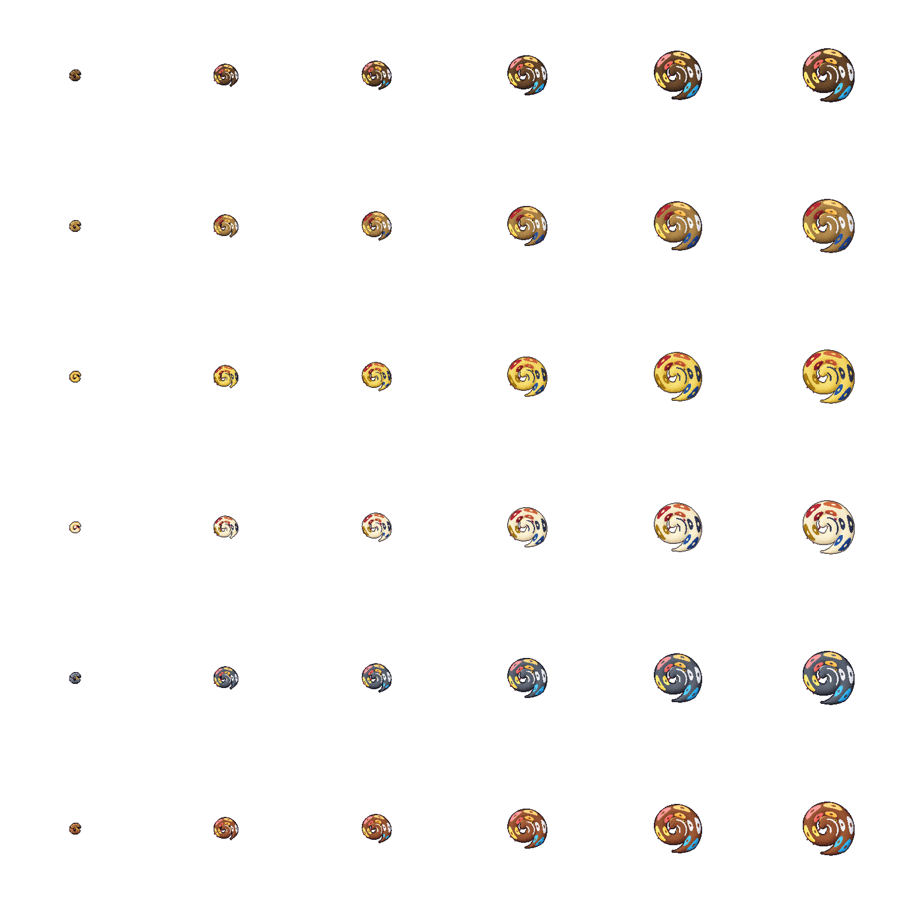

# Git snake

Git snake draws a pixel-art ball python from a GitHub account's public activity.
Its languages color the blotches along its flanks, its contributions grow it, its
streaks light a stripe down its back, and the day that just ended decides how it
moves: slithering laps on a busy day, a stretched-out tongue-flicking watch on the
first day back, and a tight coiled ball, the "ball" in ball python, after weeks of
quiet. A nightly workflow puts the snake on a profile README as a looping GIF, the
same tool runs from the command line, and the Rust library underneath is the same
crate.

<picture>
  <source media="(prefers-color-scheme: dark)" srcset="docs/morphs-dark.png" />
  
</picture>

## How the snake reads your activity

| Your activity | The snake |
| --- | --- |
| Total contributions | Length and thickness, from a hatchling to a full-grown python |
| Languages (GitHub's colors) | The pigment of each blotch: red, orange, yellow, blue, or shadow gray |
| Current weekly streak | A bright dorsal stripe that builds over 13 weeks and fades after the streak ends |
| Longest streak | Duller to more vivid colors, then iridescent glints |
| A quiet day: 14+ / 60+ days | Rest, a loose coil; deep rest, the tightest ball |
| First contribution of the week | Alert: stretched out, tongue flicking fast |
| A milestone or a standout week | Dart: two fast slithering laps |
| Anything else | Cruise: one slow slither |

The profile owner picks one of six morphs, the snake's ground color: `normal`
(the wild type), `pastel`, `banana`, `albino`, `axanthic`, or `cinnamon`.

## Repository Structure

```text
.
├── .github/      workflows, issue forms, and Dependabot
├── docs/         the getting-started guide and the render sheets
├── examples/     the profile workflow and the snake library generator
├── src/          the library and the git-snake command
├── tests/        the public-boundary tests and their fixtures
└── action.yml    the GitHub Action
```

## Usage

### Requirements

- For a snake on your profile README: a GitHub account. The Action runs in your
  profile repository's workflow with its built-in token.
- For the command line: Rust at or above the `rust-version` in
  [Cargo.toml](Cargo.toml), plus the [GitHub CLI](https://cli.github.com),
  authenticated.
- For the library: Rust at or above that same version.

[docs/getting-started.md](docs/getting-started.md) walks through all three: the
Action in a profile workflow, the command line, and the library.

## Credits

This is a fork of [git-koi](https://github.com/yalongwastaken/git-koi) by Anthony
Yalong, which draws a koi from the same data. The collection, history, streak,
behavior-selection, and encoding pipeline is his; the koi renderer, coats, and
motion are redrawn here for a ball python. Both are MIT licensed.

## License

MIT. See [LICENSE](LICENSE).
